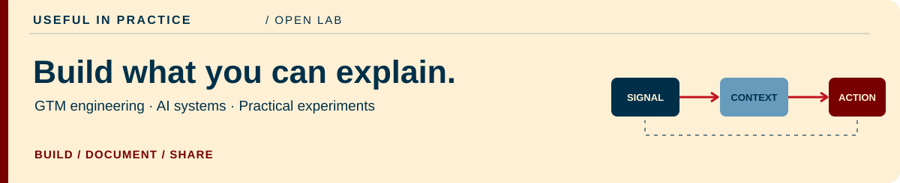

  

# Hi, I'm Stephen Stilwell.

**I build practical systems for the messy space between technology and business.**

My background spans systems integration, autonomous systems, product ownership, and business development. These days, I'm exploring GTM engineering and AI-powered automation through [Useful in Practice](https://stephenstilwell.com/), my independent technology publication and workbench.

This GitHub is where I share working code, readable guides, and the decisions behind the builds. I'm most interested in systems that show their evidence, make tradeoffs visible, and help someone take a useful next step.

[**Useful in Practice**](https://stephenstilwell.com/) · [**LinkedIn**](https://www.linkedin.com/in/stilwellstephen/) · [**All public repositories**](https://github.com/stephenstilwell?tab=repositories)

## What I'm working on

| Area | What I care about |
| --- | --- |
| **GTM engineering** | Buyer signals, account research, ICP fit, practical revenue workflows, and clear handoffs to people. |
| **AI systems and automation** | Agent-assisted research, reliable integrations, source provenance, and useful limits on automation. |
| **Systems and product engineering** | How software components work together, how people use them, and how complex behavior can be made understandable. |
| **Commercial Systems Engineering** | An idea I'm exploring: applying signal detection, decision systems, and feedback loops beyond outbound sales. |

## Featured open-source work

### [GTM Signal Lab](https://github.com/stephenstilwell/gtm-signal-lab)

A self-hosted workspace for turning public company activity into **reviewable commercial hypotheses**, not automatic sales claims. It imports signals, compares them against an ideal customer profile, preserves evidence and revision history, and exports findings for human review.

- **Stack:** Node.js, SQLite, browser UI
- **Try it:** `npm ci` then `npm run demo` in the cloned repository
- **Start learning:** [Hands-on tutorial](https://github.com/stephenstilwell/gtm-signal-lab/blob/main/docs/tutorial.md) · [Architecture and scoring](https://github.com/stephenstilwell/gtm-signal-lab/blob/main/docs/architecture.md) · [Contributing](https://github.com/stephenstilwell/gtm-signal-lab/blob/main/CONTRIBUTING.md)

The demo uses synthetic data. A signal is not proof of buying intent, and the project does not send outreach or write to a CRM.

### [Ironworks / Frontier](https://github.com/stephenstilwell/factory-game)

A Godot 4 factory-building project exploring production chains, logistics, progression, and interactive systems. It's a different side of my engineering interests, but the same curiosity about how connected systems behave.

[Explore the project and setup instructions](https://github.com/stephenstilwell/factory-game#readme)

## Guides and resources

If you're here to learn rather than install something, these are useful starting points:

- [From a public signal to a reviewable opportunity](https://github.com/stephenstilwell/gtm-signal-lab/blob/main/docs/tutorial.md): an end-to-end exercise with fictional sample data.
- [GTM Signal Lab architecture](https://github.com/stephenstilwell/gtm-signal-lab/blob/main/docs/architecture.md): data flow, scoring decisions, source access, and limitations.
- [Useful in Practice](https://stephenstilwell.com/): independent Field Notes, software guides, and interactive tools.

## Questions I'm exploring

- Can a GTM system explain *why* an opportunity deserves attention, with sources a person can check?
- How should human review fit into workflows that use AI agents and automated research?
- What makes a business's product information useful to AI-assisted buyers? This is a research interest, not a shipped project here yet.
- Where else can GTM engineering principles help, particularly in technical industries, customer lifecycle work, and partnerships?

## Building in public

I prefer a runnable example to an impressive diagram that can't be tested. For the work I publish, I aim to document setup, assumptions, failure modes, and where human judgment still matters.

Found an issue or a better approach? Open an issue in the relevant repository. If you're building something related, I enjoy comparing notes.

**Stay curious. Make it useful.**

[stephenstilwell.com](https://stephenstilwell.com/) · [LinkedIn](https://www.linkedin.com/in/stilwellstephen/)
